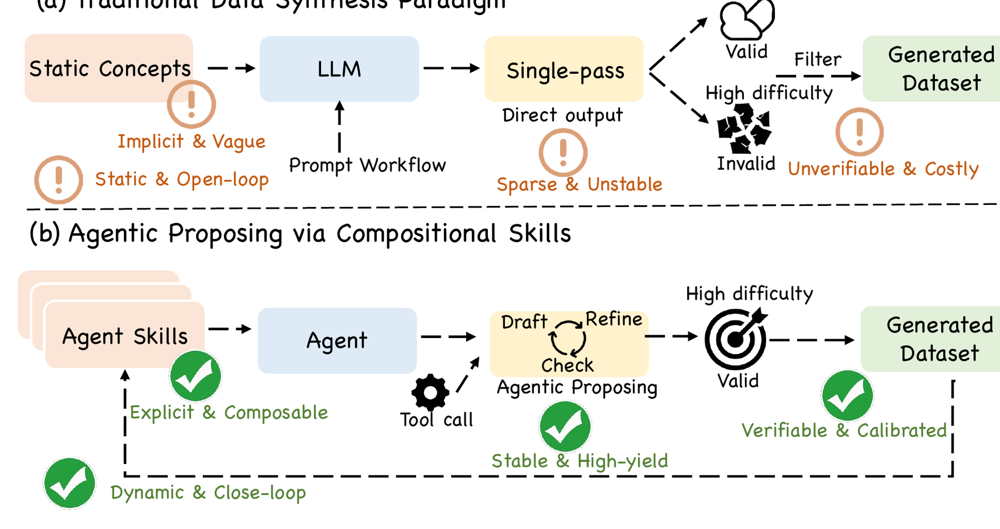
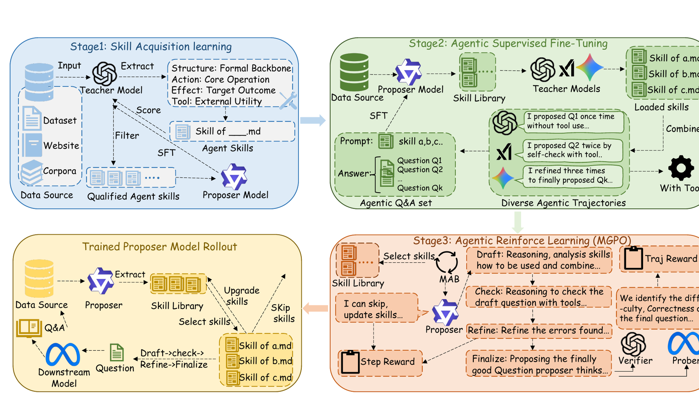
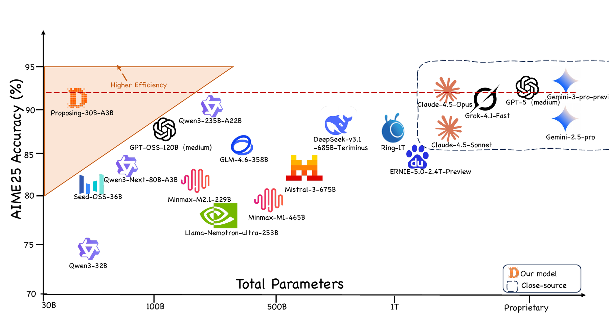
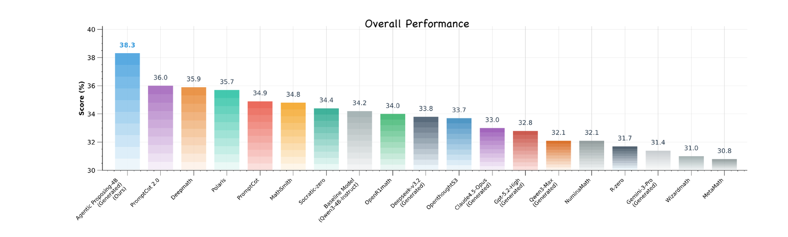
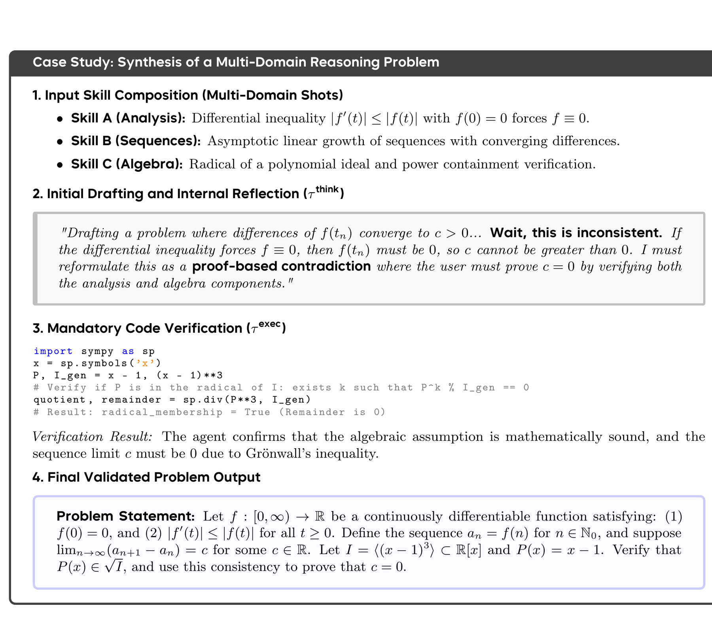

<div align="center">

# Agentic Proposing

## Enhancing Large Language Model Reasoning via Compositional Skill Synthesis

**ICML 2026 (Poster)**

Zhengbo Jiao<sup>1,2,3</sup>, Shaobo Wang<sup>2</sup>, Zifan Zhang<sup>4</sup>, Xuan Ren<sup>1</sup>, Wei Wang<sup>1</sup>, Bing Zhao<sup>1,*</sup>, Hu Wei<sup>1,†</sup>, Linfeng Zhang<sup>2,†</sup>

<sup>1</sup>AI DATA, Alibaba Group Holding Limited &nbsp;&nbsp; <sup>2</sup>EPIC Lab, Shanghai Jiao Tong University<br>
<sup>3</sup>Shanghai University of Finance and Economics &nbsp;&nbsp; <sup>4</sup>Wuhan University<br>
<sup>*</sup>Project Leader &nbsp;&nbsp; <sup>†</sup>Corresponding Authors

[](https://arxiv.org/abs/2602.03279)
[](https://icml.cc/Downloads/2026)
[](https://openreview.net/forum?id=bLbBxDTjbq)
[](https://github.com/Frostlinx/Agentic-Proposing)
[](https://github.com/Frostlinx/Agentic-Proposing/actions/workflows/tests.yml)
[](https://www.python.org/)
[](LICENSE)

</div>

> **TL;DR.** Agentic Proposing reframes reasoning-data synthesis as a closed-loop sequential decision process. A proposer dynamically selects and composes modular Agent Skills, reasons over intermediate states, invokes tools, prunes incompatible skills, and verifies a candidate before submission. The paper trains **Agentic-Proposer-4B** with Agentic SFT and Multi-Granularity Policy Optimization (MGPO); this initial code release exposes the proposing loop, skill system, tools, evidence layer, recursive composition, and verification harness.

## News

- **2026-08-05:** The initial Agentic Proposing codebase is now open source.
- **2026-05:** Agentic Proposing was accepted to **ICML 2026 as a Poster**.
- **2026-02-03:** The [arXiv preprint](https://arxiv.org/abs/2602.03279) was released.

## Abstract

High-quality verifiable data are central to improving complex reasoning, but manual annotation is expensive and difficult to scale. Existing synthesis methods often trade off structural validity against difficulty: strict templates remain valid but restrict complexity, while unconstrained generation can produce inconsistent or unsolvable instances. Agentic Proposing addresses this problem by treating synthesis as compositional logic engineering. A specialized agent selects modular skills and follows an iterative Draft-Check-Refine-Finalize process with internal reflection and tool use. The resulting trajectories improve downstream reasoning across mathematics, coding, and science; a 30B solver trained on only 11,000 synthesized trajectories reaches **91.6% on AIME 2025**.

## From Open-Loop Generation to Agentic Proposing

<p align="center">
  
</p>
<p align="center"><em>Figure 1. Traditional open-loop synthesis versus Agentic Proposing via compositional skills.</em></p>

The framework models synthesis as a partially observable decision process. At step $t$, the proposer observes

$$o_t = \langle K_t, h_t, \sigma_t \rangle,$$

where $K_t$ is the active skill set, $h_t$ is the interaction history, and $\sigma_t$ is the current synthesis stage. The action space includes:

- **Cognitive actions** for reasoning and self-reflection.
- **Executable actions** $\tau_{exec}$ for tools such as code execution, retrieval, and verification.
- **Skill-edit actions** $\tau_{edit}$ for pruning or updating the active skill set.
- **Terminal submission** $\tau_{submit}$ after the candidate satisfies the verification gates.

Each Agent Skill is formalized as a structured tuple

$$k = \langle \iota, \mu, \delta, \tau \rangle,$$

representing its reasoning intent, construction method, difficulty effect, and tool-use hint. This representation makes skills explicit, inspectable, and composable rather than burying them in a monolithic prompt.

## Agentic-Proposer Synthesis Pipeline

<p align="center">
  
</p>
<p align="center"><em>Figure 3. The complete paper pipeline: Skill Acquisition, Agentic SFT, and Agentic RL with MGPO.</em></p>

The paper develops the proposer in three stages:

1. **Skill Acquisition and Library Formalization.** A Teacher extracts atomic skills from datasets, corpora, and web sources. Candidates are scored and filtered into an autonomous Skill Library.
2. **Agentic Supervised Fine-Tuning.** Teacher models generate diverse proposing trajectories with internal reflection, tool execution, dynamic skill pruning, and verifier-gated final questions.
3. **Agentic Reinforcement Learning.** MGPO combines trajectory-level and stage-level advantages so that long synthesis chains receive credit at both the final-output and intermediate-action levels.

During inference, the proposer repeatedly executes **Draft -> Check -> Refine -> Finalize**. Skills can be skipped, updated, or recomposed as the trajectory evolves.

### Core research contributions

- **Agentic problem synthesis:** a goal-driven, self-correcting alternative to one-shot prompting.
- **Composable Agent Skills:** modular reasoning units that support explicit orchestration and difficulty control.
- **Agentic post-training:** Agentic SFT followed by MGPO for multi-granularity credit assignment.
- **High-signal synthetic data:** strong downstream transfer from only 10K-11K trajectories.
- **Cross-domain generalization:** consistent gains in mathematics, code, and scientific reasoning.

## Main Results

### Parameter efficiency

<p align="center">
  
</p>
<p align="center"><em>Figure 2. Proposing-30B-A3B reaches 91.6% AIME25 Mean@64 and rivals substantially larger open and proprietary models.</em></p>

### Overall contest-mathematics performance

<p align="center">
  
</p>
<p align="center"><em>Figure 4. Agentic Proposing-4B achieves 38.3 overall under a fixed 10,000-trajectory budget.</em></p>

### Headline results

| Solver and training data | Evaluation | Zero-shot | Agentic Proposing | Gain |
|---|---|---:|---:|---:|
| Qwen3-4B, 10K math trajectories | Math overall (Mean@64) | 34.2 | **38.3** | **+4.1** |
| Qwen3-30B-A3B, 11K math + code trajectories | Math + code overall | 75.6 | **81.5** | **+5.9** |
| Qwen3-30B-A3B, 11K trajectories | AIME 2025 (Mean@64) | 85.0 | **91.6** | **+6.6** |
| Qwen3-4B, 10K cross-domain trajectories | Cross-domain overall (Mean@1) | 56.1 | **61.4** | **+5.3** |

<details>
<summary><b>Table 1 - Full 4B contest-mathematics comparison (10K trajectories)</b></summary>

All methods use the same GRPO recipe. Values are Mean@64 accuracy; Overall is the unweighted average.

| Method | AIME24 | AIME25 | HMMT-Feb | AMO-Bench | Overall |
|---|---:|---:|---:|---:|---:|
| Qwen3-4B zero-shot | 49.8 | 46.7 | 31.0 | 9.3 | 34.2 |
| MetaMath | 44.6 | 43.5 | 27.4 | 7.8 | 30.8 |
| WizardMath | 44.8 | 44.0 | 27.8 | 7.6 | 31.0 |
| PromptCoT | 50.1 | 47.3 | 33.1 | 9.1 | 34.9 |
| PromptCoT 2.0 | 50.9 | 48.5 | 34.2 | 10.2 | 36.0 |
| NuminaMath | 47.3 | 43.9 | 29.1 | 8.2 | 32.1 |
| MathSmith | 50.3 | 47.1 | 32.9 | 9.1 | 34.8 |
| OpenR1-Math | 49.4 | 45.8 | 31.8 | 8.9 | 34.0 |
| DeepMath | 51.2 | 48.2 | 33.7 | 10.3 | 35.9 |
| Polaris | 51.7 | 47.4 | 33.8 | 9.8 | 35.7 |
| OpenThoughts-S3 | 49.6 | 46.1 | 30.6 | 8.4 | 33.7 |
| R-Zero | 45.8 | 44.3 | 30.1 | 6.7 | 31.7 |
| Socratic-Zero | 50.2 | 46.9 | 31.3 | 9.1 | 34.4 |
| GPT-5.2-High generated | 47.7 | 45.8 | 29.9 | 7.8 | 32.8 |
| Gemini-3-Pro generated | 45.5 | 43.1 | 28.7 | 8.1 | 31.4 |
| Qwen3-Max generated | 46.2 | 43.4 | 30.2 | 8.5 | 32.1 |
| Claude-4.5-Opus generated | 48.3 | 45.7 | 30.8 | 7.4 | 33.0 |
| DeepSeek-V3.2-Speciale generated | 49.5 | 45.6 | 31.2 | 8.8 | 33.8 |
| **Agentic Proposing (Ours)** | **53.6** | **51.2** | **36.5** | **11.8** | **38.3** |

</details>

<details>
<summary><b>Table 2 - 30B math and code comparison (11K trajectories)</b></summary>

Math uses Mean@64; LiveCodeBench v5/v6 uses Best-of-5.

| Method | AIME24 | AIME25 | HMMT | LCB v5 | LCB v6 | Overall |
|---|---:|---:|---:|---:|---:|---:|
| Qwen3-30B-A3B zero-shot | 87.7 | 85.0 | 71.4 | 68.1 | 66.0 | 75.6 |
| OpenCodeReasoning | 85.0 | 81.1 | 64.9 | 70.8 | 67.4 | 73.8 |
| OpenMathReasoning | 87.9 | 86.1 | 72.2 | 65.7 | 58.4 | 74.1 |
| PromptCoT 2.0 | 92.1 | 89.8 | 76.7 | **74.2** | 71.0 | 80.8 |
| OpenThoughts-S3 | 85.7 | 84.7 | 70.0 | 68.3 | 67.2 | 75.2 |
| OpenR1 | 86.3 | 84.9 | 68.9 | 68.3 | 63.7 | 74.4 |
| **Agentic Proposing (Ours)** | **93.5** | **91.6** | **77.6** | 73.4 | **71.2** | **81.5** |

</details>

### Cross-domain transfer

| Method | OlympicArena | MMLU-Redux | MMLU-Pro | GPQA | SuperGPQA | Overall |
|---|---:|---:|---:|---:|---:|---:|
| Qwen3-4B zero-shot | 42.8 | 84.1 | 69.6 | 62.0 | 42.8 | 56.1 |
| **Agentic Proposing (Ours)** | **47.2** | **87.3** | **75.2** | **68.3** | **50.1** | **61.4** |
| **Absolute gain** | **+4.4** | **+3.2** | **+5.6** | **+6.3** | **+7.3** | **+5.3** |

## Analysis and Ablations

The controlled ablations use a Qwen3-4B downstream solver trained on 10,000 synthesized trajectories and evaluated on AIME with Mean@64.

### Proposer specialization

| Proposer configuration | AIME Avg. | Gain vs. raw GPT-5.2 |
|---|---:|---:|
| GPT-5.2-High (raw prompting) | 32.8 | - |
| + Skill Library | 34.6 | +1.8 |
| + Agentic Workflow | 36.4 | +3.6 |
| **Agentic-Proposer-4B** | **38.3** | **+5.5** |

### Agentic pipeline

| Proposer configuration | AIME Avg. | Gain |
|---|---:|---:|
| One-shot proposing | 31.5 | - |
| + Tool use | 33.8 | +2.3 |
| + Internal reflection | 33.4 | +2.1 |
| **Full Draft-Check-Refine pipeline** | **38.3** | **+6.8** |

### RL objective

| Optimization objective | AIME Avg. | Gain |
|---|---:|---:|
| Standard GRPO (trajectory level) | 31.8 | - |
| MGPO without stage-level advantage | 35.1 | +3.3 |
| **Full MGPO** | **38.3** | **+6.5** |

Additional paper diagnostics show that 14.5% of trajectories actively prune skills; editing raises valid synthesis from 68.7% to 82.3%; and the full gated verifier committee reaches 98% validity accuracy with 98% human agreement.

## Qualitative Agentic Refinement

<details>
<summary><b>Figure 5 - Expand the full synthesis trajectory</b></summary>

<p align="center">
  
</p>

The proposer combines multi-domain skills, detects a contradiction between an analytical constraint and a sequence-growth assumption, invokes code-based verification, and changes the problem objective before final submission. This case illustrates why the refinement loop is more than a longer prompt: the trajectory modifies its own construction state in response to executable evidence.

</details>

## Initial Code Release

> [!IMPORTANT]
> The paper contains the full three-stage training recipe. The **current public release focuses on the inference-time proposing system and research harness**. Agentic SFT, MGPO training code, official training data, and official checkpoints are not included in this initial release.

| Paper or system component | Current release | Implementation |
|---|:---:|---|
| Closed-loop Draft-Check-Refine-Finalize harness | ✅ | `src/agentic_proposing/core/` |
| Persistent run state, checkpoints, and JSONL trajectories | ✅ | `src/agentic_proposing/core/` |
| Progressive skill discovery and lazy `SKILL.md` loading | ✅ | `src/agentic_proposing/skills/` |
| Skill pruning, staging, versioning, lineage, and promotion | ✅ | `src/agentic_proposing/skills/` |
| Recursive composition (`A+B->C`, `C+A->D`) | ✅ | `src/agentic_proposing/skills/` |
| Benchmark and textbook/corpus skill acquisition | ✅ | `src/agentic_proposing/corpus/` |
| Workspace, retrieval, Python, web, and external tools | ✅ | `src/agentic_proposing/tools/` |
| Self-check, terminal gates, optional model committee | ✅ | `src/agentic_proposing/artifacts/` |
| OpenAI-compatible and Anthropic Teacher adapters | ✅ | `src/agentic_proposing/providers/` |
| Agentic SFT | Not released | Paper Stage 2 |
| MGPO training | Not released | Paper Stage 3 |
| Official data and checkpoints | Not released | - |

### Engineering extensions in this release

- Filesystem-backed Agent Skills with discovery metadata and progressive context loading.
- Recursive skill evolution: accepted tasks and traces can produce staged emergent skills.
- Replay-gated composite promotion before a new skill can become a parent in later rounds.
- Configurable search backends (Brave, Tavily, SearXNG), safe web ingestion, and an Evidence Store.
- Restricted one-shot Python evaluation and persistent multi-cell Python sessions.
- Allow/deny/ask permissions, lifecycle hooks, bounded context, long-output artifacts, and process cleanup.
- Dynamic JSON-over-HTTP tool catalogs with transactional schema refresh.
- Deterministic and optional model-based verification with freshness-bound self-checks.

## Installation

Python 3.11 or newer is required.

```bash
git clone https://github.com/Frostlinx/Agentic-Proposing.git
cd Agentic-Proposing
python -m venv .venv
```

Activate the environment:

```bash
# Linux / macOS
source .venv/bin/activate

# Windows PowerShell
.venv\Scripts\Activate.ps1
```

Install the package and research dependencies:

```bash
python -m pip install -e ".[dev]"
```

## Quick Start

### Offline end-to-end demo

The deterministic Teacher exercises skill search, progressive loading, tool execution, self-check, and gated submission without any API key or network access.

```bash
agentic-proposing demo --workspace ./demo-workspace
```

A successful run returns `"status": "completed"` and stores the inspectable trajectory at `demo-workspace/runs/<run_id>/events.jsonl`.

The longer deterministic release case demonstrates a failed first self-check followed by refinement, a passing second self-check, and terminal submission:

```bash
python examples/full_loop_case.py --workspace ./case-workspace
```

### Use a frontier Teacher

```bash
agentic-proposing init ./research-workspace --with-examples
```

Copy either `examples/config.openai-compatible.json` or `examples/config.anthropic.json` to `research-workspace/config.json`, select the Teacher model, and set the environment variable named by `api_key_env` in that configuration. Then run:

```bash
agentic-proposing run \
  "Synthesize one evidence-grounded task and verify it before submission" \
  --workspace ./research-workspace
```

Network access, subprocess execution, registry writes, domain allowlists, and external tool providers are independently permissioned and remain disabled until explicitly enabled. See [Configuration](docs/CONFIGURATION.md).

## Skill Acquisition and Recursive Composition

Extract one candidate skill per benchmark item:

```bash
agentic-proposing acquire benchmark examples/sources/synthetic_benchmark.jsonl \
  --workspace ./research-workspace
```

Ingest a textbook/corpus and acquire grounded skills:

```bash
agentic-proposing ingest examples/sources/synthetic_renal_notes.md \
  --workspace ./research-workspace

agentic-proposing acquire corpus examples/sources/synthetic_renal_notes.md \
  --workspace ./research-workspace
```

Run recursive skill composition with independent validation replays:

```bash
agentic-proposing evolve \
  "compose evidence-grounded reasoning skills" \
  --workspace ./research-workspace \
  --rounds 3 \
  --replays-per-composition 2
```

A composite is staged first. Only candidates that pass the configured replay threshold are promoted and become eligible as parents in later composition rounds.

## Code Architecture

```text
Teacher / Proposer
        |
        v
AgentHarness ---- progressive tool discovery ---- Tool Registry
     |                                             |
     |-- run state + JSONL trajectory              |-- workspace / retrieval
     |-- bounded context                           |-- Python sessions
     |-- permissions + hooks                       |-- web + evidence
     '-- Draft -> Check -> Refine -> Submit         '-- external providers
        |
        |-------- Skill Registry -------- atomic / composite / staged
        |-------- Evidence Store -------- benchmark / textbook / web
        '-------- Verification ---------- self-check / voters / audit
```

| Path | Responsibility |
|---|---|
| `src/agentic_proposing/core/` | Harness, context, hooks, state, and event storage |
| `src/agentic_proposing/skills/` | Skill format, registry, extraction, composition, replay, lifecycle |
| `src/agentic_proposing/tools/` | Tool protocol and built-in tool families |
| `src/agentic_proposing/corpus/` | Benchmark/document parsing, chunking, and evidence storage |
| `src/agentic_proposing/artifacts/` | Task bundles, self-checks, submit gates, model verification |
| `src/agentic_proposing/providers/` | Model-provider adapters and deterministic Teachers |
| `examples/` | Configurations, synthetic sources, and complete-loop examples |
| `tests/` | Offline unit and integration coverage |

Further documentation:

- [Architecture](docs/ARCHITECTURE.md)
- [Paper-to-code mapping](docs/PAPER_MAPPING.md)
- [Skill package format](docs/SKILL_FORMAT.md)
- [Tool protocol](docs/TOOL_PROTOCOL.md)
- [Configuration and permissions](docs/CONFIGURATION.md)
- [Testing](docs/TESTING.md)

## Reproducibility and Testing

```bash
python -m pytest
```

The offline suite currently contains 36 tests plus 3 subtests and covers the harness, recursive evolution, progressive disclosure, permissions, skill management, verification, corpus ingestion, web safety, and provider-independent tools. GitHub Actions runs the suite on Python 3.11 and 3.12.

The included medical examples are synthetic engineering fixtures. They are not clinical data and are not medical guidance.

## Citation

If you find Agentic Proposing useful, please cite:

```bibtex
@inproceedings{jiao2026agentic,
  title     = {Agentic Proposing: Enhancing Large Language Model Reasoning via Compositional Skill Synthesis},
  author    = {Jiao, Zhengbo and Wang, Shaobo and Zhang, Zifan and Ren, Xuan and Wang, Wei and Zhao, Bing and Wei, Hu and Zhang, Linfeng},
  booktitle = {International Conference on Machine Learning (ICML)},
  year      = {2026}
}
```

## Contact

- Linfeng Zhang: `zhanglinfeng1997@outlook.com`
- Hu Wei: `kongwang@alibaba-inc.com`
- Implementation questions: [GitHub Issues](https://github.com/Frostlinx/Agentic-Proposing/issues)

## License

The code is released under the [MIT License](LICENSE). Figures are reproduced from the paper, which is distributed under [CC BY 4.0](https://creativecommons.org/licenses/by/4.0/).
