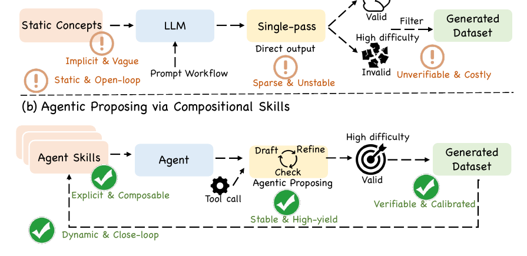

<div align="center">

# Agentic Proposing

### Enhancing Large Language Model Reasoning via Compositional Skill Synthesis

Zhengbo Jiao<sup>1</sup>, Shaobo Wang<sup>1</sup>, Zifan Zhang<sup>1</sup>, Xuan Ren<sup>1</sup>, Wei Wang<sup>1</sup>, Bing Zhao<sup>1</sup>, Hu Wei<sup>2,3</sup>, Linfeng Zhang<sup>1,4</sup>

<sup>1</sup>AI DATA, Alibaba Group &nbsp; <sup>2</sup>EPIC Lab, Shanghai Jiao Tong University  
<sup>3</sup>Shanghai University of Finance and Economics &nbsp; <sup>4</sup>Wuhan University

[](https://arxiv.org/abs/2602.03279)
[](https://icml.cc/Downloads/2026)
[](https://openreview.net/forum?id=bLbBxDTjbq)
[](https://www.python.org/)
[](https://github.com/Frostlinx/Agentic-Proposing/actions/workflows/tests.yml)
[](LICENSE)

</div>

> **TL;DR.** Agentic Proposing turns data synthesis from a one-shot generation process into a closed-loop agentic workflow. A proposer dynamically retrieves and composes reusable skills, invokes tools, reflects on intermediate results, prunes ineffective skills, and submits only after verification. This initial code release provides the executable proposing harness, progressive skill system, recursive composition, corpus/benchmark ingestion, and verification stack.

## News

- **2026-08-05:** The initial Agentic Proposing codebase is now open source.
- **2026-05:** Agentic Proposing was accepted to **ICML 2026 as a Poster**.
- **2026-02-03:** The [arXiv preprint](https://arxiv.org/abs/2602.03279) was released.

## Overview

Conventional synthesis pipelines select a fixed strategy and generate a sample in a single pass. Agentic Proposing instead maintains an evolving state over the available skill set, interaction history, and current synthesis stage. The proposer can reason, execute tools, revise its working state, remove unhelpful skills, and trigger a gated submission. This makes skill selection and composition part of the synthesis trajectory itself.

<p align="center">
  
</p>
<p align="center"><em>Figure 1. Open-loop synthesis versus the closed-loop Agentic Proposing workflow.</em></p>

The paper formulates this process as a partially observable decision process. At step t, the proposer observes the active skills, interaction history, and synthesis stage. It then chooses among cognitive actions, executable tool actions, skill edits, and terminal submission.

### What makes it agentic?

- **Compositional skills.** Atomic procedures can be composed into reusable higher-order skills rather than copied into a static prompt.
- **Closed-loop proposing.** Drafting, checking, refinement, tool execution, and submission occur within one observable trajectory.
- **Dynamic skill management.** Skills are progressively disclosed, activated on demand, pruned when ineffective, versioned, and promoted only after validation.
- **Verifier-guided synthesis.** Deterministic checks and optional isolated model voters gate terminal submission.
- **Recursive growth.** Accepted tasks and trajectories can yield new skills, which become parents in later composition rounds.

## Main Results

The following numbers are reported in the paper. “Overall” denotes the corresponding benchmark average used in each table; gains are absolute points over the stated baseline.

| Setting | Evaluation | Baseline | Agentic Proposing | Gain |
|---|---|---:|---:|---:|
| Qwen3-4B, 10K math trajectories | Math overall | 34.2 | **38.3** | **+4.1** |
| Qwen3-30B-A3B, 11K mixed trajectories | Math + code overall | 75.6 | **81.5** | **+5.9** |
| Qwen3-4B, 10K cross-domain trajectories | Cross-domain overall | 56.1 | **61.4** | **+5.3** |
| GPT-5.2 synthesis | Raw → agentic workflow | 32.8 | **36.4** | **+3.6** |
| GPT-5.2 + 4B proposer | Raw GPT-5.2 → trained proposer | 32.8 | **38.3** | **+5.5** |

See the [paper](https://arxiv.org/abs/2602.03279) for per-benchmark results, training details, ablations, and verifier analysis.

## Initial Code Release Scope

This release focuses on the inference-time agentic workflow and its research harness. We explicitly distinguish released components from paper components that are not yet included.

| Component | Status | Location |
|---|:---:|---|
| Closed-loop proposing harness and persistent trajectories | ✅ | `src/agentic_proposing/core/` |
| Progressive skill discovery, loading, pruning, and lineage | ✅ | `src/agentic_proposing/skills/` |
| Atomic and recursive composite skills (`A+B→C`, `C+A→D`) | ✅ | `src/agentic_proposing/skills/` |
| Benchmark and textbook/corpus ingestion | ✅ | `src/agentic_proposing/corpus/` |
| Workspace, retrieval, Python, web, and external tool protocols | ✅ | `src/agentic_proposing/tools/` |
| Self-check, terminal gates, and optional model committee | ✅ | `src/agentic_proposing/artifacts/` |
| OpenAI-compatible and Anthropic Teacher adapters | ✅ | `src/agentic_proposing/providers/` |
| Agentic SFT and MGPO training pipeline | — | Not included in this release |
| Official training data and model checkpoints | — | Not included in this release |

The current repository is suitable for studying and extending the **proposing loop**, building skill libraries, synthesizing tasks with a frontier Teacher, and replaying verifier-gated trajectories. It should not be interpreted as a release of the paper's full training stack.

## Installation

Agentic Proposing requires Python 3.11 or newer.

```bash
git clone https://github.com/Frostlinx/Agentic-Proposing.git
cd Agentic-Proposing
python -m venv .venv
python -m pip install -e ".[dev]"
```

Activate the environment with `source .venv/bin/activate` on Linux/macOS or `.venv\Scripts\activate` on Windows.

## Quick Start: Offline End-to-End Demo

The repository includes a deterministic Teacher, so the full draft → check → verify → submit path can be exercised without an API key or network access.

```bash
agentic-proposing demo --workspace ./demo-workspace
```

A successful run returns `"status": "completed"` and writes an inspectable JSONL event trajectory under `demo-workspace/runs/<run_id>/events.jsonl`.

Run the test suite with:

```bash
python -m pytest
```

## Use a Frontier Model as the Teacher

1. Initialize a workspace and example skill registry.

```bash
agentic-proposing init ./research-workspace --with-examples
```

2. Copy either `examples/config.openai-compatible.json` or `examples/config.anthropic.json` to `research-workspace/config.json`.
3. Select the Teacher model and set the API-key environment variable named in that config.
4. Run one proposing session.

```bash
agentic-proposing run \
  "Synthesize one evidence-grounded task and verify it before submission" \
  --workspace ./research-workspace
```

Network access, subprocesses, registry writes, domain allowlists, and external tools are controlled independently. They remain disabled unless explicitly enabled in the workspace configuration; see [Configuration](docs/CONFIGURATION.md).

## Skill Acquisition and Recursive Composition

Skills are stored as filesystem packages with a compact discovery manifest and a lazily loaded procedural `SKILL.md`. This separates skill management from prompt stuffing: only summaries are visible during discovery, and full instructions enter context after explicit loading.

Extract one skill candidate per benchmark item:

```bash
agentic-proposing acquire benchmark examples/sources/synthetic_benchmark.jsonl \
  --workspace ./research-workspace
```

Parse a textbook or corpus source and extract grounded skills:

```bash
agentic-proposing ingest examples/sources/synthetic_renal_notes.md \
  --workspace ./research-workspace

agentic-proposing acquire corpus examples/sources/synthetic_renal_notes.md \
  --workspace ./research-workspace
```

Run recursive composition with independent validation replays:

```bash
agentic-proposing evolve \
  "compose evidence-grounded reasoning skills" \
  --workspace ./research-workspace \
  --rounds 3 \
  --replays-per-composition 2
```

A promoted composite becomes a first-class skill and can be selected in the next round. Successful tasks and observable traces are also reverse-mined into staged emergent skills.

## System Architecture

```text
Teacher / Proposer
        │
        ▼
AgentHarness ── progressive tool discovery ── Tool Registry
     │                                            │
     ├── Run state + JSONL trajectory             ├── workspace / retrieval
     ├── bounded context                          ├── Python sessions
     ├── permissions + hooks                      ├── web + evidence
     └── Draft → Check → Refine → Submit          └── external providers
        │
        ├──────── Skill Registry ──────── atomic / composite / staged
        ├──────── Evidence Store ─────── benchmark / textbook / web
        └──────── Verification ───────── self-check / voters / audit
```

Important design details are documented separately:

- [Architecture](docs/ARCHITECTURE.md)
- [Mapping from the paper to the implementation](docs/PAPER_MAPPING.md)
- [Skill package format](docs/SKILL_FORMAT.md)
- [Tool protocol](docs/TOOL_PROTOCOL.md)
- [Configuration and permissions](docs/CONFIGURATION.md)
- [Testing](docs/TESTING.md)

## Repository Layout

```text
Agentic-Proposing/
├── src/agentic_proposing/   # runtime, skills, tools, corpus, providers
├── tests/                   # offline unit and integration tests
├── examples/                # configs, synthetic sources, full-loop case
├── docs/                    # architecture and protocol documentation
├── assets/                  # README figures
└── pyproject.toml
```

## Citation

If you find this work useful, please cite:

```bibtex
@article{jiao2026agentic,
  title   = {Agentic Proposing: Enhancing Large Language Model Reasoning via Compositional Skill Synthesis},
  author  = {Jiao, Zhengbo and Wang, Shaobo and Zhang, Zifan and Ren, Xuan and Wang, Wei and Zhao, Bing and Wei, Hu and Zhang, Linfeng},
  journal = {arXiv preprint arXiv:2602.03279},
  year    = {2026}
}
```

## Acknowledgements

We thank the open-source model, evaluation, and scientific Python communities. The example medical sources in this repository are synthetic and are provided only to demonstrate the engineering workflow; they are not medical guidance.

## Contact

For research questions, please contact the corresponding authors listed in the paper: `zhanglinfeng1997@outlook.com` and `kongwang@alibaba-inc.com`. For implementation issues, please open a [GitHub issue](https://github.com/Frostlinx/Agentic-Proposing/issues).

## License

This code is released under the [MIT License](LICENSE).
